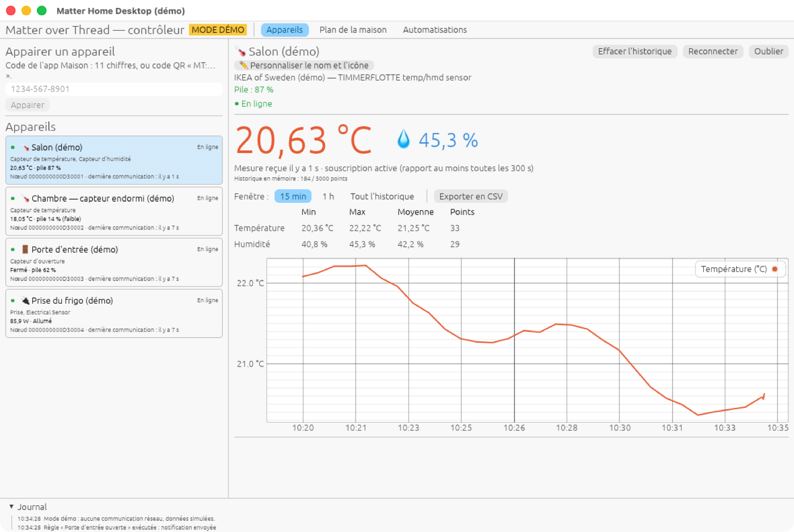
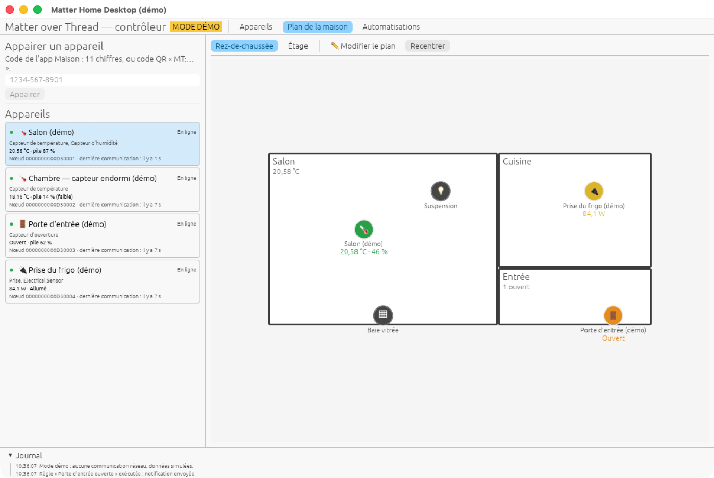
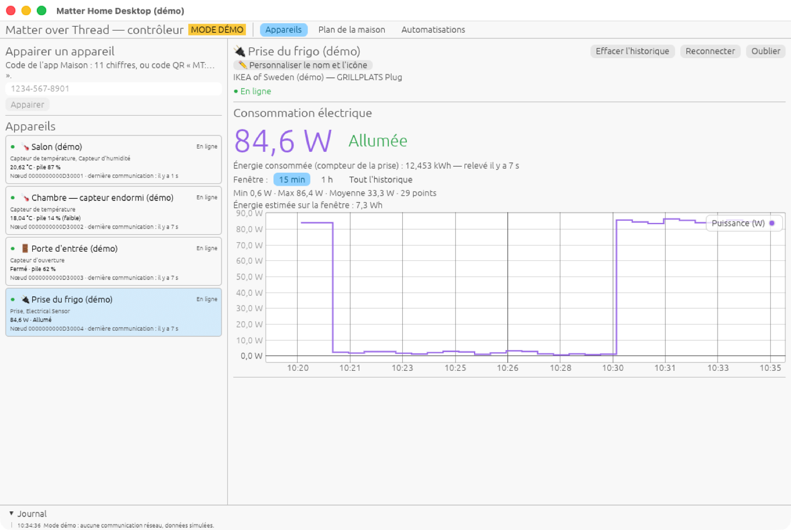
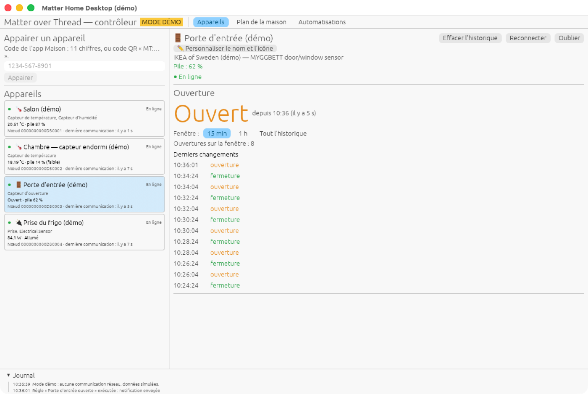
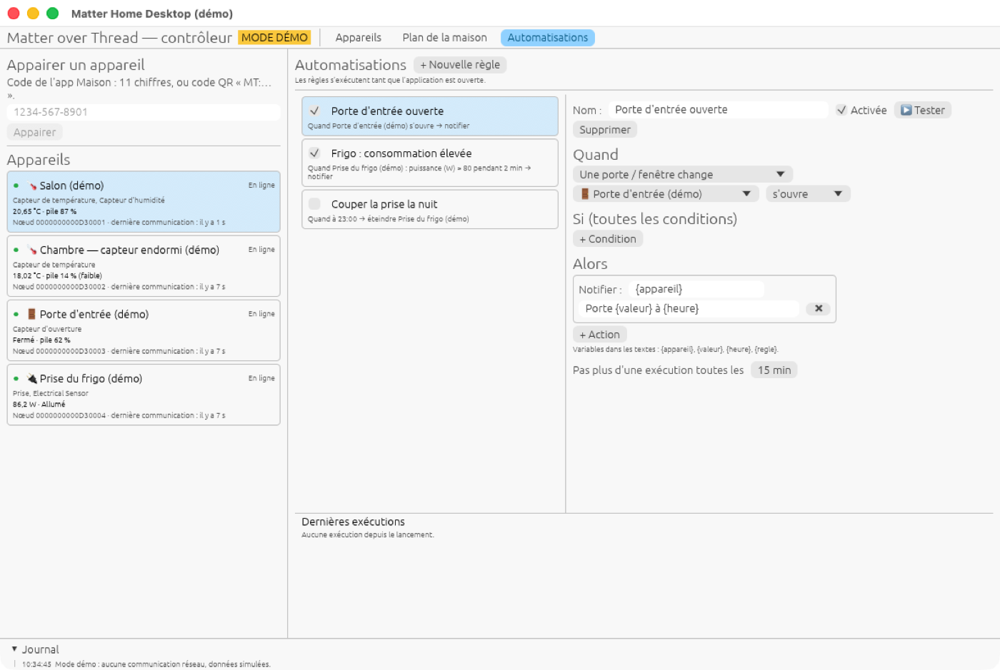
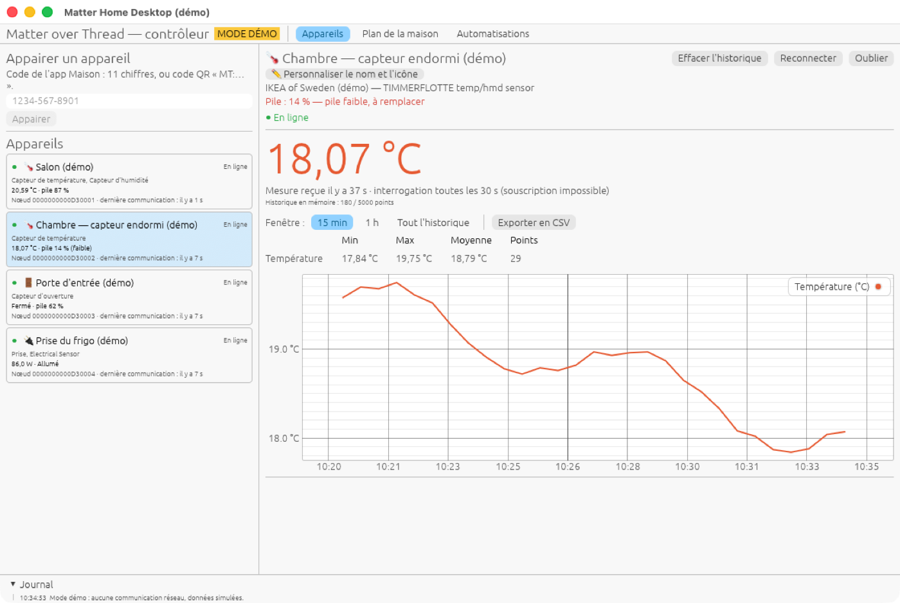

# Matter Home Desktop

Application de bureau pour macOS qui pilote et observe vos appareils **Matter** (Thread ou
Wi-Fi) déjà installés dans Apple Maison : mesures en direct, plan de la maison,
automatisations. Elle s'ajoute comme un contrôleur de plus ; tout reste en local, sans cloud.

<table>
  <tr>
    <td width="50%"></td>
    <td width="50%"></td>
  </tr>
  <tr>
    <td align="center"><b>Thermomètre</b> — valeur en direct, statistiques, historique</td>
    <td align="center"><b>Plan de la maison</b> — pièces, appareils, porte ouverte en orange</td>
  </tr>
  <tr>
    <td width="50%"></td>
    <td width="50%"></td>
  </tr>
  <tr>
    <td align="center"><b>Prise connectée</b> — puissance, énergie consommée</td>
    <td align="center"><b>Détecteur d'ouverture</b> — état, ouvertures, chronologie</td>
  </tr>
  <tr>
    <td width="50%"></td>
    <td width="50%"></td>
  </tr>
  <tr>
    <td align="center"><b>Automatisations</b> — « Quand… Si… Alors… »</td>
    <td align="center"><b>Capteur sur pile</b> — niveau et alerte de pile faible</td>
  </tr>
</table>

<sub>Captures prises en mode démo : appareils et mesures simulés.</sub>

## Ce que fait l'application

- **Appairage** avec le code de l'app Maison (11 chiffres ou QR `MT:…`), sans Bluetooth.
- **Appareils** : état en ligne / injoignable, reconnexion automatique, nom et icône au choix.
- **Thermomètres** : température et humidité en direct, graphique, min / max / moyenne, export CSV.
- **Détecteurs d'ouverture** : ouvert / fermé, depuis quand, chronologie.
- **Prises** : puissance en watts, énergie consommée, état allumée / éteinte.
- **Piles** : niveau et alerte de pile faible.
- **Plan de la maison** : étages, pièces, appareils placés avec leur état en direct.
- **Automatisations** : « quand la porte s'ouvre la nuit, envoyer une notification », « éteindre
  la prise à 23 h »… Notifications macOS, marche / arrêt des prises et lampes, webhooks.

Testé avec des appareils IKEA (TIMMERFLOTTE, MYGGBETT, GRILLPLATS, BILRESA, KAJPLATS) et
des routeurs de bordure Thread HomePod.

## Installation

Il faut un Mac et [Rust](https://rustup.rs). Le Mac doit être sur le même réseau local que
vos HomePod (ou autres routeurs de bordure Thread).

```bash
git clone https://github.com/killerwolf/matter-home-desktop.git
```

```bash
cd matter-home-desktop && cargo build --release
```

Pour découvrir l'application sans appareil, lancez le **mode démo** :

```bash
./target/release/matter-home-desktop --demo
```

Puis, avec vos appareils :

```bash
./target/release/matter-home-desktop
```

Au premier lancement, macOS peut demander l'accès au **réseau local** : acceptez.

## Ajouter un appareil

1. Dans l'app **Maison** : appui long sur l'appareil → **Réglages** → **Activer le mode
   jumelage**. Maison affiche un code à 11 chiffres.
2. Dans Matter Home Desktop : collez le code dans « Appairer un appareil », puis **Appairer**.

L'appareil reste dans Apple Maison ; l'application devient un contrôleur de plus. Pour un
capteur sur pile, appuyez sur son bouton juste avant pour le réveiller.

## Utilisation

Trois onglets en haut de la fenêtre :

- **Appareils** : la liste à gauche, la fiche de l'appareil sélectionné à droite.
- **Plan de la maison** : « ✏ Modifier le plan » pour dessiner les pièces et y glisser vos
  appareils, puis « ✔ Terminer » pour suivre leur état en direct.
- **Automatisations** : « + Nouvelle règle », puis choisissez Quand, Si et Alors. Le bouton
  « ▶ Tester » exécute la règle tout de suite.

Les règles ne s'exécutent que **tant que l'application est ouverte**.

## Vos données

Tout reste sur votre Mac, dans
`~/Library/Application Support/dev.matter-home-desktop.MatterHomeDesktop/` : identité du
contrôleur, appareils, plan, règles et 7 jours d'historique des mesures. Rien n'est envoyé
ailleurs, sauf les webhooks que vous configurez vous-même. Détails :
[docs/donnees.md](docs/donnees.md).

## Limites

- Projet personnel, en cours d'évolution, testé uniquement sur macOS.
- L'application ne vérifie pas que les appareils sont certifiés Matter.
- Pas encore de déclencheur « appui sur un bouton », ni de mode service sans fenêtre.
- Certains capteurs sur pile s'appairent difficilement : voir
  [docs/depannage.md](docs/depannage.md).

## Documentation

| | |
|---|---|
| [Guide d'utilisation](docs/utilisation.md) | fiches des appareils, nom et icône, export CSV, options de lancement |
| [Plan de la maison](docs/plan.md) | dessin, couleurs, sauvegarde |
| [Automatisations](docs/automatisations.md) | déclencheurs, conditions, actions, variables |
| [Données et confidentialité](docs/donnees.md) | fichiers, historique, rétention, remise à zéro |
| [Dépannage](docs/depannage.md) | problèmes connus, diagnostic réseau |
| [Architecture](docs/architecture.md) | choix techniques, fonctionnement interne |
| [Contribuer](CONTRIBUTING.md) | compiler, tester, proposer une modification |

## Licence

MIT, voir [LICENSE](LICENSE). Le dossier `vendor/matc` est une copie modifiée de
[matc](https://github.com/tom-code/rust-matc), sous licence BSD-2-Clause.
