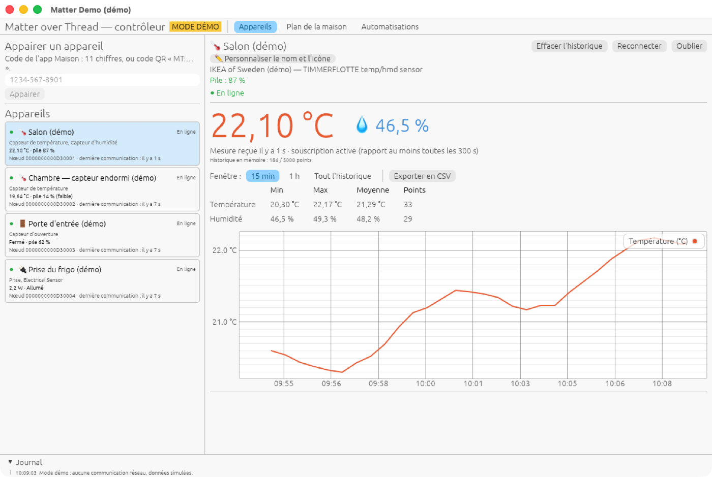
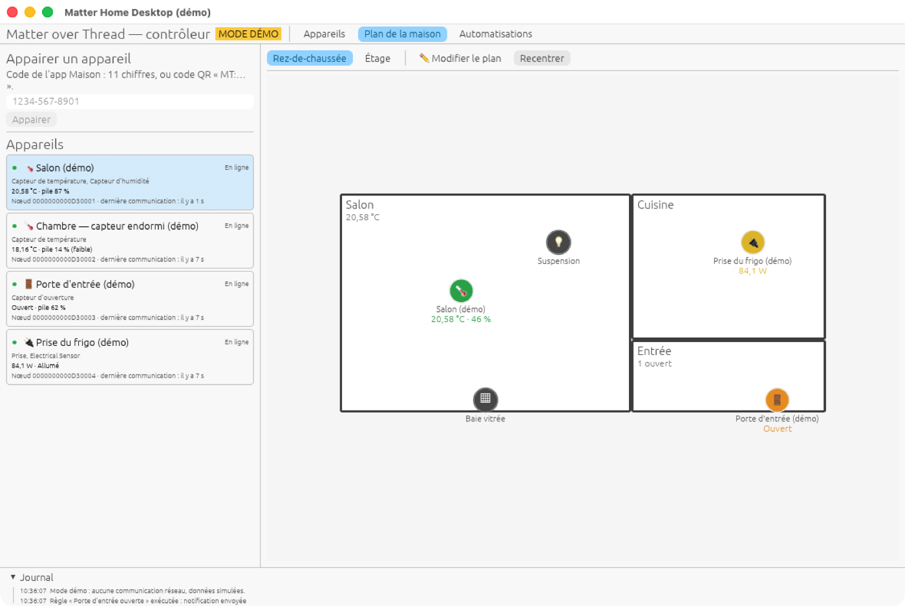
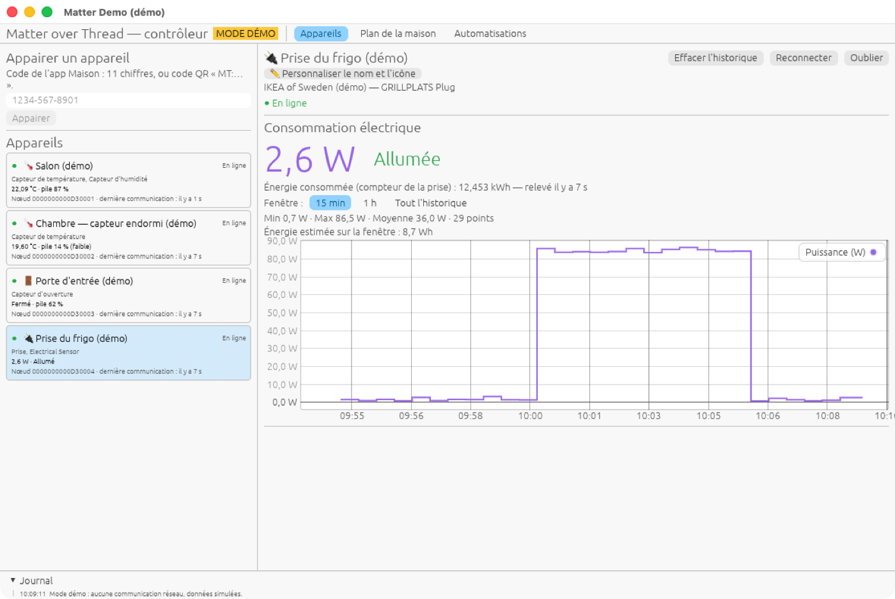
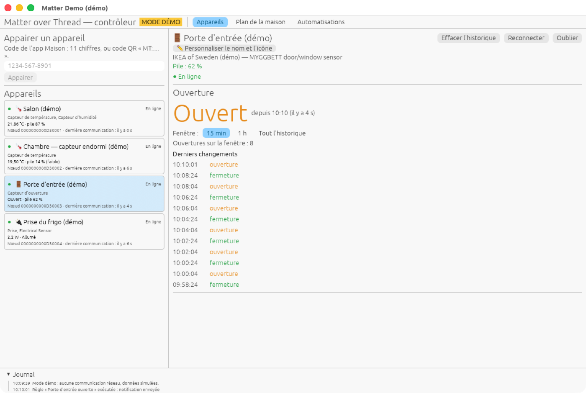
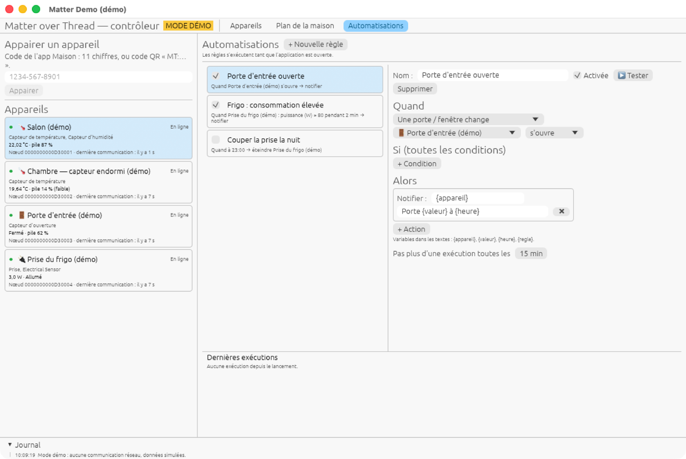
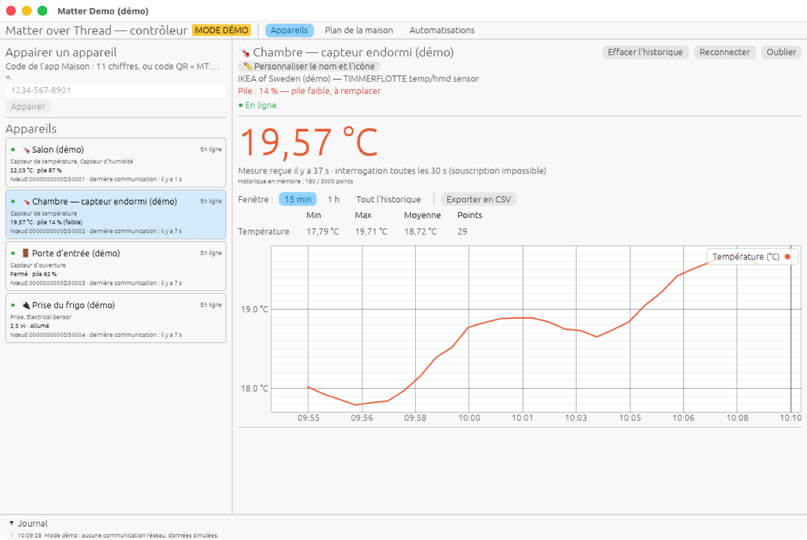

# Matter Home Desktop

[](https://github.com/killerwolf/matter-home-desktop/actions/workflows/release.yml)
[](https://github.com/killerwolf/matter-home-desktop/releases/latest)

Pilote et observe vos appareils **Matter** (Thread ou Wi-Fi) déjà installés dans Apple Maison :
mesures en direct, plan de la maison, automatisations. Il s'ajoute comme un contrôleur de plus ;
tout reste en local, sans cloud.

**Depuis la version 1, l'application est en deux parties :**

| | Rôle | Où |
|---|---|---|
| **Serveur** (`matter-home-server`) | Tourne en continu, sans fenêtre, sur un Mac du réseau local (un ancien Mac convient). Il pilote les appareils, exécute les automatisations, garde les données et l'historique. | Service macOS qui démarre avec le Mac |
| **Client** (« Matter Home Desktop ») | L'application avec fenêtre : elle affiche et commande, sans stocker de données. On y saisit l'adresse du serveur, un identifiant et un mot de passe. | N'importe quel Mac du réseau |

Liaison chiffrée (HTTPS, certificat du serveur épinglé par le client), un seul compte, aucun cloud.
Vous venez de la v0.2.1 ? [Reprenez vos données](docs/migration.md) sans réappairer un seul appareil.

<table>
  <tr>
    <td width="50%"></td>
    <td width="50%"></td>
  </tr>
  <tr>
    <td align="center"><b>Thermomètre</b> — valeur en direct, statistiques, historique</td>
    <td align="center"><b>Plan de la maison</b> — pièces, appareils, porte ouverte en orange</td>
  </tr>
  <tr>
    <td width="50%"></td>
    <td width="50%"></td>
  </tr>
  <tr>
    <td align="center"><b>Prise connectée</b> — puissance, énergie consommée</td>
    <td align="center"><b>Détecteur d'ouverture</b> — état, ouvertures, chronologie</td>
  </tr>
  <tr>
    <td width="50%"></td>
    <td width="50%"></td>
  </tr>
  <tr>
    <td align="center"><b>Automatisations</b> — « Quand… Si… Alors… »</td>
    <td align="center"><b>Capteur sur pile</b> — niveau et alerte de pile faible</td>
  </tr>
</table>

<sub>Captures prises en mode démo : appareils et mesures simulés.</sub>

## Ce que fait l'application

- **Appairage** avec le code de l'app Maison (11 chiffres ou QR `MT:…`), sans Bluetooth.
- **Appareils** : état en ligne / injoignable, reconnexion automatique, nom et icône au choix.
- **Thermomètres** : température et humidité en direct, graphique, min / max / moyenne, export CSV.
- **Détecteurs d'ouverture** : ouvert / fermé, depuis quand, chronologie.
- **Prises** : puissance en watts, énergie consommée, état allumée / éteinte.
- **Volets et stores** : ouvrir, fermer, arrêter, aller à une position, historique
  d'ouverture ; y compris derrière un **pont Matter** (Somfy TaHoma…), chaque volet étant un
  appareil à part entière.
- **Piles** : niveau et alerte de pile faible.
- **Plan de la maison** : étages, pièces, appareils placés avec leur état en direct.
- **Automatisations** : « quand la porte s'ouvre la nuit, envoyer une notification », « éteindre
  la prise à 23 h », « fermer les volets à 21 h 30 »… Notifications macOS, marche / arrêt des
  prises et lampes, commandes de volets, webhooks.

Testé avec des appareils IKEA (TIMMERFLOTTE, MYGGBETT, GRILLPLATS, BILRESA, KAJPLATS) et
des routeurs de bordure Thread HomePod. La prise en charge des ponts et des volets suit la
spécification Matter (Window Covering, Bridged Device Basic Information) ; elle n'a pas
encore été vérifiée avec une TaHoma réelle : les retours sont bienvenus.

## Installation

Téléchargez la dernière version sur la
[page des versions](https://github.com/killerwolf/matter-home-desktop/releases/latest) ;
les nouveautés de chacune sont dans [CHANGELOG.md](CHANGELOG.md). (Cette adresse ne montre que les
versions définitives : pour une pré-version, `-rc.1` par exemple, voir la
[liste complète](https://github.com/killerwolf/matter-home-desktop/releases).) Deux fichiers, un par partie :

### 1. Le serveur, sur le Mac qui reste allumé

**Le plus simple : `MatterHomeServer-<version>-universal.dmg`**, l'application « Matter Home
Server » (macOS 10.15 minimum sur Intel, 11 sur Apple Silicon). Glissez-la dans **Applications**
et ouvrez-la : une icône apparaît dans la barre de menus, et une petite fenêtre guide la première
configuration (reprendre une sauvegarde ou créer une nouvelle maison, puis le compte). **Pas de
Terminal, pas de mot de passe administrateur.** Elle s'ouvre à la connexion et empêche la veille ;
voir [docs/installation-serveur.md](docs/installation-serveur.md) (ouverture de session
automatique, capot ouvert, secteur).

**Option avancée : l'archive en ligne de commande**, `matter-home-server-<version>-macos.tar.gz` : le programme (arm64 et Intel, macOS 10.15 minimum
sur Intel, 11 sur Apple Silicon), `install.sh`, `uninstall.sh` et un fichier de service launchd.
`install.sh` l'installe comme service qui démarre avec le Mac, relancé s'il plante, sous votre
compte (jamais root). Il ne touche jamais seul à la veille ni au pare-feu : il affiche les
commandes à lancer. Avant de lancer quoi que ce soit, retirez la quarantaine :
`xattr -dr com.apple.quarantine <dossier de l'archive>`. **Guide pas à pas, pour non-développeurs :
[docs/installation-serveur.md](docs/installation-serveur.md).** Pour passer du service à l'application :
`./uninstall.sh` (vos données restent), puis ouvrez Matter Home Server.

Pour reprendre vos appareils, plan, règles et historique de la v0.2.1 :
**[docs/migration.md](docs/migration.md)**.

> **Ne lancez jamais deux instances** (deux serveurs, ou la v0.2.1 avec le serveur) avec la même
> identité Matter : leurs abonnements se chassent et les règles s'exécutent deux fois. Arrêtez la
> v0.2.1 sur tous vos Mac avant de démarrer le serveur.

### 2. Le client, sur le Mac où vous regardez

`MatterHomeDesktop-<version>-universal.dmg`, pour **macOS 12 et plus**, Apple Silicon comme Intel
(environ 13 Mo). Ouvrez-le et glissez **Matter Home Desktop** dans **Applications**. Au
lancement, saisissez l'adresse du serveur, l'identifiant et le mot de passe ; la première fois,
le client affiche l'empreinte du certificat du serveur (à comparer avec `matter-home-server
fingerprint`) puis ne fait confiance qu'à lui. Au premier lancement, macOS demande l'accès au
**réseau local** : acceptez (Réglages Système → Confidentialité et sécurité → Réseau local),
sans quoi le client ne voit rien. Le même réglage concerne le serveur : voir le guide
d'installation. Le client n'a besoin de voir que le serveur ;
c'est le serveur qui doit être sur le même réseau local que vos HomePod (ou autres routeurs de
bordure Thread).

### Premier lancement : « Matter Home Desktop est endommagé »

L'application n'est pas abîmée : elle n'est pas encore signée avec un certificat Apple
Developer payant, et macOS bloque les applications non signées téléchargées sur internet.
Pour l'autoriser, lancez une fois dans le Terminal :

```bash
xattr -cr "/Applications/Matter Home Desktop.app"
```

Ouvrez ensuite l'application normalement. C'est à refaire après chaque nouvelle version.

### Essayer sans appareil

Le **mode démo** du serveur simule thermomètres, porte, prise, volets et automatisations (dossier
temporaire, écoute sur `127.0.0.1:8443`, compte « demo » dont le mot de passe est affiché) :

```bash
matter-home-server --demo
```

Lancez le client et connectez-le à `https://127.0.0.1:8443`.

### Compiler depuis les sources

Avec [Rust](https://rustup.rs) installé :

```bash
git clone https://github.com/killerwolf/matter-home-desktop.git && cd matter-home-desktop
```

```bash
scripts/bundle.sh --dmg          # le client : dist/MatterHomeDesktop-<version>-<arch>.dmg
scripts/package-server.sh        # le serveur : dist/matter-home-server-<version>-macos.tar.gz
```

Les deux sont créés dans `dist/` (universels quand les deux cibles Apple sont installées avec
`rustup target add aarch64-apple-darwin x86_64-apple-darwin`). Plus de détails dans
[CONTRIBUTING.md](CONTRIBUTING.md).

## Accès à distance

Pour joindre le serveur depuis l'extérieur (4G, autre Wi-Fi) **sans rien ouvrir sur Internet**,
utilisez [Tailscale](https://tailscale.com) (gratuit en usage personnel) : un réseau privé
(« tailnet ») entre vos appareils. Le serveur continue de parler Matter à vos appareils sur le
réseau local ; seul le client change d'adresse.

1. Installez Tailscale sur le Mac serveur et sur chaque appareil qui se connecte (Mac, iPhone,
   iPad), avec le **même compte**. Dans la console d'administration de Tailscale, activez
   **MagicDNS** et **HTTPS**.
2. Chaque appareil a alors un nom de la forme `mon-mac.tailnet-xxxx.ts.net`.
3. **Client de bureau** : dans l'écran de connexion, gardez l'adresse de la maison et remplissez
   **« Adresse à distance »** avec `mon-mac.tailnet-xxxx.ts.net:8443` (plusieurs adresses :
   séparez-les par un espace). À chaque connexion, le client essaie l'adresse de la maison, puis
   les autres, et prend la première qui répond : avec l'**empreinte du serveur** pour une adresse directe, ou avec un certificat public valable pour une adresse `https://…ts.net/` (port 443, voir « Certificat » plus bas) ; il bascule tout
   seul en quittant le Wi-Fi de la maison. Hors de chez vous, la barre d'état indique « à
   distance » et les caméras restent sur le flux réduit (« Fluide ») ; « Haute » reste possible
   mais est lourde en 4G.
4. **App web (iPhone, iPad)** : dans le menu de l'app serveur, cochez **« Accès web
   (Tailscale) »**. Le serveur est alors publié sur votre tailnet seulement (jamais sur Internet)
   à l'adresse `https://mon-mac.tailnet-xxxx.ts.net/app/`, avec un certificat reconnu par
   Safari. Ouvrez-la, connectez-vous, puis « Sur l'écran d'accueil ». Détails :
   [docs/web-app.md](docs/web-app.md).

**Certificat.** Le certificat auto-signé du serveur ne porte pas le nom `….ts.net`. Le client
ne s'en soucie pas : il compare l'**empreinte** du certificat, la même par n'importe quelle
adresse, donc `mon-mac.tailnet-xxxx.ts.net:8443` fonctionne. Seule exception : l'adresse
publiée par la case « Accès web » (`https://mon-mac.tailnet-xxxx.ts.net/`, port 443) présente
le certificat Let's Encrypt de Tailscale ; le client le valide alors par la chaîne de confiance
publique, comme un navigateur (nom et dates contrôlés), **sans épinglage** : il ne vérifie plus
que le serveur est bien le vôtre par son empreinte, seulement que le nom `….ts.net` est le bon.
Vérifiez donc le nom de votre Mac. Tout autre certificat invalide est refusé. Voir
[docs/acces-distant.md](docs/acces-distant.md).

## Ajouter un appareil

1. Dans l'app **Maison** : appui long sur l'appareil → **Réglages** → **Activer le mode
   jumelage**. Maison affiche un code à 11 chiffres.
2. Dans Matter Home Desktop : collez le code dans « Appairer un appareil », puis **Appairer**.

L'appareil reste dans Apple Maison ; l'application devient un contrôleur de plus. Pour un
capteur sur pile, appuyez sur son bouton juste avant pour le réveiller.

## Utilisation

Trois onglets en haut de la fenêtre :

- **Appareils** : la liste à gauche, la fiche de l'appareil sélectionné à droite.
- **Plan de la maison** : « ✏ Modifier le plan » pour dessiner les pièces et y glisser vos
  appareils, puis « ✔ Terminer » pour suivre leur état en direct.
- **Automatisations** : « + Nouvelle règle », puis choisissez Quand, Si et Alors. Le bouton
  « ▶ Tester » exécute la règle tout de suite.

Les règles sont exécutées par **le serveur**, en continu, même quand aucun client n'est ouvert :
les notifications sont envoyées aux clients connectés (un client fermé n'en reçoit pas).

## Vos données

Tout reste sur le Mac du **serveur**, dans
`~/Library/Application Support/dev.matter-home-desktop.MatterHomeDesktop/` : identité du
contrôleur, appareils, plan, règles, 7 jours d'historique des mesures, compte et certificat du
serveur. Le client ne garde que l'adresse du serveur, l'empreinte du certificat et un jeton de
session. Rien n'est envoyé ailleurs, sauf les webhooks que vous configurez vous-même. Détails :
[docs/donnees.md](docs/donnees.md).

## Limites

- Projet personnel, en cours d'évolution, testé uniquement sur macOS.
- L'application ne vérifie pas que les appareils sont certifiés Matter.
- Pas encore de déclencheur « appui sur un bouton ». Pas de serveur Linux ni
  de comptes multiples (hors version 1). L'accès à distance passe par Tailscale (voir plus haut).
- Le serveur n'est pas signé avec un certificat Apple payant (signature « ad hoc ») : le pare-feu
  macOS demande une autorisation manuelle, voir le guide d'installation.
- Certains capteurs sur pile s'appairent difficilement : voir
  [docs/depannage.md](docs/depannage.md).

## Documentation

| | |
|---|---|
| [Installer le serveur](docs/installation-serveur.md) | service launchd pas à pas, veille, pare-feu, arrêter, désinstaller |
| [Migrer la v0.2.1](docs/migration.md) | reprendre ses données sans réappairer, installation neuve, reprise après coupure |
| [Guide d'utilisation](docs/utilisation.md) | fiches des appareils, nom et icône, export CSV, options de lancement |
| [Plan de la maison](docs/plan.md) | dessin, couleurs, sauvegarde |
| [Automatisations](docs/automatisations.md) | déclencheurs, conditions, actions, variables |
| [Données et confidentialité](docs/donnees.md) | fichiers, historique, rétention, changer de Mac, remise à zéro |
| [Accès à distance](docs/acces-distant.md) | Tailscale, adresses multiples, certificats, flux caméra |
| [Dépannage](docs/depannage.md) | problèmes connus, diagnostic réseau |
| [Architecture](docs/architecture.md) | choix techniques, fonctionnement interne |
| [Contribuer](CONTRIBUTING.md) | compiler, tester, proposer une modification |

## Licence

MIT, voir [LICENSE](LICENSE). Le dossier `vendor/matc` est une copie modifiée de
[matc](https://github.com/tom-code/rust-matc), sous licence BSD-2-Clause.
